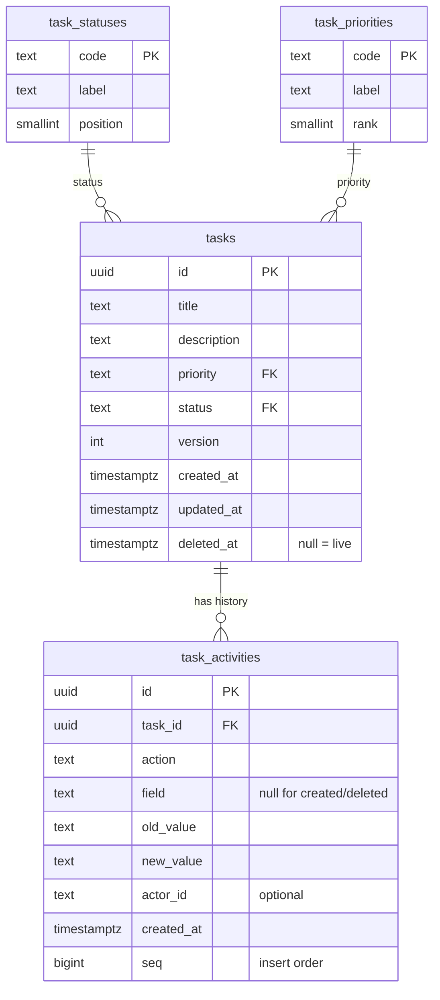

# Database

Source of truth: [`db/schema.sql`](../db/schema.sql) (idempotent, `npm run db:migrate`) and [`db/seed.sql`](../db/seed.sql) (synthetic, idempotent).
Engine: PostgreSQL (embedded PGlite by default, or any PostgreSQL 15+ via `DATABASE_URL`).

## ER diagram

*Caption:* two core tables from the brief plus two lookup tables that hold the allowed statuses and priorities.

## Table catalogue

| Table | Purpose | PK | Key FKs |
|---|---|---|---|
| `task_statuses` | Allowed statuses, synced from `shared/src/domain.ts` | `code` | - |
| `task_priorities` | Allowed priorities, synced from `shared/src/domain.ts` | `code` | - |
| `tasks` | The tasks | `id` | `status → task_statuses.code`, `priority → task_priorities.code` |
| `task_activities` | Append-only change history | `id` | `task_id → tasks.id` |

## Column detail

### `tasks`

| Column | Type | Null | Default | Constraint | Notes |
|---|---|---|---|---|---|
| id | uuid | no | `gen_random_uuid()` | PK | Not guessable, safe in URLs |
| title | text | no | - | `CHECK 1..200 chars after trim` | Mirrors zod rule |
| description | text | no | `''` | `CHECK ≤ 5000 chars` | Empty string instead of NULL: one "no description" value |
| priority | text | no | - | FK → `task_priorities` | |
| status | text | no | - | FK → `task_statuses` | Default `todo` is applied by the service (from the shared definition) |
| version | integer | no | `1` | `CHECK ≥ 1` | Optimistic-lock token, +1 on every update |
| created_at | timestamptz | no | `now()` | `CHECK updated_at ≥ created_at` | Immutable after insert |
| updated_at | timestamptz | no | `now()` | | Set to `clock_timestamp()` on update |
| deleted_at | timestamptz | yes | NULL | | Soft-delete marker |

### `task_activities`

| Column | Type | Null | Default | Constraint | Notes |
|---|---|---|---|---|---|
| id | uuid | no | `gen_random_uuid()` | PK | |
| task_id | uuid | no | - | FK → `tasks.id` ON DELETE CASCADE | Cascade only matters for a hard purge; the app soft-deletes |
| action | text | no | - | `CHECK IN (created, edited, status_changed, deleted)` | |
| field | text | yes | NULL | `CHECK IN (title, description, priority, status)`; required when action is edited/status_changed | One row per changed field |
| old_value / new_value | text | yes | NULL | | Stored as text: statuses/priorities as codes, labels resolved in UI |
| actor_id | text | yes | NULL | | Optional per brief; NULL because there is no auth |
| created_at | timestamptz | no | `clock_timestamp()` | | `clock_timestamp()` (not `now()`), so later writes get later times |
| seq | bigint | no | identity | | Insert order. Breaks ties when two rows from one edit get the same timestamp, so "title" is always listed before "priority" |

All rows in `task_activities` are **immutable**: the app only inserts, never updates or deletes them.

## Constraints and why

| Constraint | Reason |
|---|---|
| FK `tasks.status → task_statuses(code)` ON DELETE RESTRICT | DB rejects any status not in the shared definition; a status can't be removed while tasks use it |
| FK `tasks.priority → task_priorities(code)` ON DELETE RESTRICT | Same for priority |
| FK `task_activities.task_id → tasks(id)` ON DELETE CASCADE | History can't point at a missing task; a future hard purge cleans up |
| `CHECK` on title length, description length | Last line of defence if a write bypasses the API |
| `CHECK (version >= 1)`, `CHECK (updated_at >= created_at)` | Basic invariants |
| `CHECK` on `action` and `field`, and "edit/status change must name a field" | History rows are always well-formed |

Why lookup tables instead of `CHECK (status IN (...))`: the brief requires **one shared definition**. A CHECK would repeat the list in SQL. With lookup tables, `migrate.ts` upserts rows from `STATUSES`, the FK enforces them, and `rank`/`position` let us sort by priority and workflow order meaningfully.

## Indexes

| Index | Columns | Query it serves | Why |
|---|---|---|---|
| `tasks_pkey` | `id` | GET/PATCH/DELETE by id | PK |
| `idx_tasks_live_updated` | `(updated_at DESC, id) WHERE deleted_at IS NULL` | Default list: no filter, newest first, paginated | Partial index: only live rows, matching every list query's `deleted_at IS NULL` |
| `idx_tasks_live_status_updated` | `(status, updated_at DESC) WHERE deleted_at IS NULL` | `?status=…` with default sort | Equality on status then ordered scan; also covers the status FK |
| `idx_tasks_live_priority_updated` | `(priority, updated_at DESC) WHERE deleted_at IS NULL` | `?priority=…` with default sort | Same for priority; covers the priority FK |
| `idx_task_activities_task_order` | `(task_id, created_at, seq)` | Timeline for one task, oldest first | Matches `WHERE task_id = $1 ORDER BY created_at, seq` exactly; covers the FK |

Not indexed on purpose: `ILIKE '%term%'` search. A B-tree can't serve a leading wildcard. At this scale the filtered sequential scan is fine. At scale, add `pg_trgm` GIN indexes on `title` and `description`.

## Cardinality

| Relationship | Type | Junction |
|---|---|---|
| task_statuses → tasks | 1:N | - |
| task_priorities → tasks | 1:N | - |
| tasks → task_activities | 1:N (≥ 1, since "created" is always written) | - |

## Normalization

3NF. Status and priority labels live only in the lookup tables. Activities store the raw old and new values as text. That is deliberate denormalisation for history: the value must be kept as it was at the time, even if a label changes later.

## Lifecycle

- **Create:** `status = todo`, `version = 1`, plus a `created` activity.
- **Update:** `version + 1`, `updated_at` refreshed, one activity per changed field (`status_changed` for status, `edited` for others).
- **Delete:** soft delete (`deleted_at` set) plus a `deleted` activity. Live queries exclude it, the API returns 404, and history is kept.
- **Status transitions:** any status can move to any status (the brief defines no transition rules). See README *Future work*.

## Seed data

`db/seed.sql` holds 12 synthetic NGO-style tasks with fixed UUIDs and matching history (created plus status changes).
`ON CONFLICT DO NOTHING` and `WHERE NOT EXISTS` make it safe to re-run. Timestamps are relative to `now()`, so the UI looks current. Run `npm run db:seed`, or `SEED_ENABLED=false` to skip.
