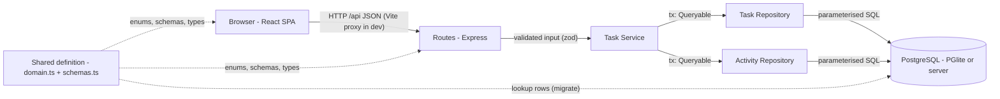
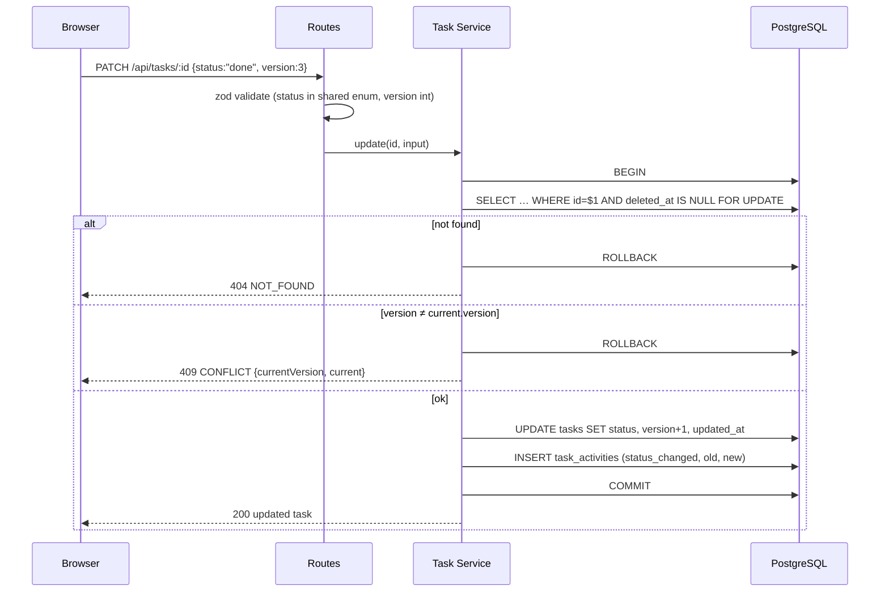
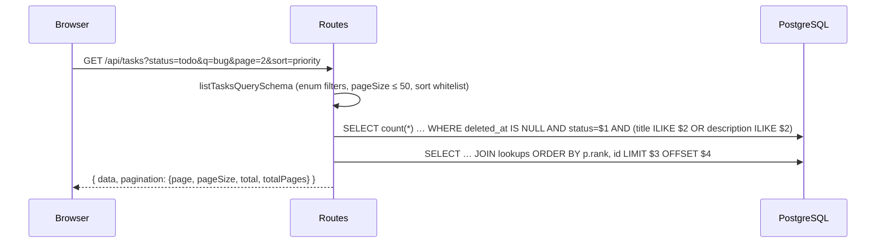

# High-Level Design — Mini Workflow Engine

## Context

Small teams lose track of who changed what. This app lets one user role create, edit, filter and delete tasks, move them through statuses, and read a complete, time-ordered history for each task.
**In scope:** task CRUD, status/priority rules from one definition, DB-side list/filter/search/sort/pagination, an activity history written transactionally with every change, consistent errors and the four UI states.
**Out of scope** (per brief): auth and accounts, queues, microservices, caching, real-time updates.

## System interaction flow



*Caption:* one request path: UI → routes → service → repositories → database. The shared package feeds the same status/priority definition into every layer.

## Components

| Name | Responsibility | Inputs | Outputs | Talks to |
|---|---|---|---|---|
| Browser - React SPA (`web/`) | Screens S-01…S-05, inline validation, loading/empty/error/success states | User actions | HTTP requests | Routes, Shared definition |
| Routes - Express (`server/src/routes`) | Parse and validate params/body with zod, map to service calls, status codes | HTTP request | JSON response or AppError | Task Service, Shared definition |
| Task Service (`server/src/services`) | Business rules: transactions, optimistic locking, diffing fields into activity rows, 404/409 | Validated input | Task / Activity DTOs | Task Repository, Activity Repository |
| Task Repository | SQL for tasks: insert, find (optionally `FOR UPDATE`), update, soft delete, list with filters | `Queryable`, typed args | Typed rows | Database |
| Activity Repository | SQL for `task_activities`: insert, list by task | `Queryable`, typed args | Typed rows | Database |
| Database | Storage, constraints (FK/CHECK), indexes, transactions, row locks | SQL | Rows | — |
| Shared definition (`shared/`) | THE list of statuses/priorities, zod schemas, response types | — | Enums, schemas, types | Browser, Routes, Database (via migrate) |

## Key flows

### Update a task (edit or status change)



*Caption:* the row lock plus the version check means concurrent writers serialise, and a stale writer gets 409.

### Create a task

```mermaid
sequenceDiagram
  participant UI as Browser
  participant R as Routes
  participant S as Task Service
  participant DB as PostgreSQL
  UI->>UI: taskFormSchema.safeParse (inline errors)
  UI->>R: POST /api/tasks {title, description, priority}
  R->>R: createTaskSchema (strict) → 422 on failure
  R->>S: create(input)
  S->>DB: BEGIN; INSERT tasks (status = DEFAULT_STATUS)
  S->>DB: INSERT task_activities ('created')
  S->>DB: COMMIT (either insert fails → ROLLBACK, nothing saved)
  S-->>UI: 201 task
  UI->>UI: navigate to detail + "Task created" banner
```

### List with filters



## Boundaries

| Layer | Owns | Never does |
|---|---|---|
| UI | Presentation, inline validation (shared schema), URL-held filters | Decide allowed values on its own; compute totals |
| Routes | HTTP concerns, input validation, status codes | SQL, business rules |
| Service | Transactions, concurrency rule, activity diffing, 404/409 | HTTP or SQL text |
| Repositories | SQL with parameters only | Business decisions, opening their own transactions |
| External integrations | None in scope | — |

## Tech choices

| Choice | Why | Alternative rejected |
|---|---|---|
| TypeScript everywhere + npm workspaces | One `shared` package gives UI and API the same enums, schemas and types | Separate repos (definitions would drift) |
| Express 5 | Small; async errors reach the error middleware natively | NestJS (too much framework for 6 endpoints) |
| zod | One schema for API validation and form validation; readable error messages | Hand-written validators (duplicated rules) |
| PostgreSQL via PGlite, `pg` when `DATABASE_URL` set | Real Postgres semantics with zero install; tests on an in-memory instance | SQLite (different SQL dialect from the production target); Docker (extra prerequisite) |
| Raw parameterised SQL (no ORM) | Queries, locks and indexes are explicit and easy to discuss | Prisma/TypeORM (hides `FOR UPDATE`, transactions and generated SQL) |
| React + Vite + react-router | Fast dev server, simple SPA routing | Next.js (SSR not needed) |

## Failure handling

| Scenario | Behaviour | Recovery |
|---|---|---|
| Activity insert fails mid-write | Whole transaction rolls back; 500 with generic message | User retries; no partial state exists |
| Unknown / malformed task id | 404 `NOT_FOUND` | UI shows S-05 Not found with link back |
| Invalid status, priority or title | 422 `VALIDATION_FAILED` with per-field details | Form shows messages next to fields |
| Malformed JSON body | 400 `BAD_REQUEST` | Client bug; same error shape |
| Concurrent edit (stale version) | 409 `CONFLICT` with current task | UI banner with **Reload** |
| API unreachable | Client raises `NETWORK` error | Error state with **Try again** |
| Unexpected exception | Logged server-side; 500 `INTERNAL`, no stack or SQL leaked | — |

## Production gaps

- Authentication and authorisation; fill `actor_id` from the session.
- Run against managed PostgreSQL (`DATABASE_URL`) with a migration tool (versioned migrations instead of one idempotent schema file).
- Trigram index for search; keyset pagination for deep pages.
- Rate limiting, request IDs and structured logging; health and readiness checks wired to the DB.
- CORS and security headers if UI and API are served from different origins.
- History retention policy for soft-deleted tasks.
